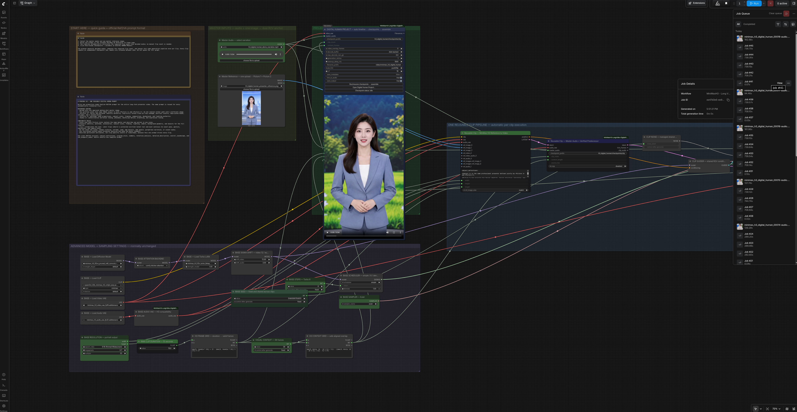

# ComfyUI MiniMax H3 Long Video Digital Human

[](LICENSE)

面向 MiniMax H3 数字人长视频的 ComfyUI 工作流与恢复组件。项目以一个主工作流为中心：长音频自动按连续 clip 生成、逐段原子落盘、断点续跑，并用低内存流式方式装配最终视频。

仓库与建议安装目录名：`ComfyUI-MiniMaxH3-LongVideo-DigitalHuman`。

**简体中文** · [English](README_EN.md) · [文档](docs/README.md) · [问题反馈](https://github.com/caitongbo/ComfyUI-MiniMaxH3-LongVideo-DigitalHuman/issues) · [安全报告](SECURITY.md) · [更新记录](CHANGELOG.md)

> 本项目是社区项目，不是 MiniMax 或 Comfy Org 官方发行版。模型权重不随仓库分发。

## 核心能力

- 长音频直接驱动最长 20 个连续 clip；默认单段约 15.08 秒、39 帧视觉上下文。
- 解码后的音频时长自动决定 clip 数；工作流只保留一套可复用生成管线和一个 Prompt。
- BASE 固定为原生 Turbo LoRA：`simple / 8 steps / denoise 1 / LoRA strength 1.0`。
- 每个 clip 独立保存为 `.safetensors`，manifest 校验参数、顺序和文件哈希。
- 安全的逐 clip 调度、失败重试、暂停、从指定片段重生成和不可变分支。
- 最终装配逐段 mmap 解码，不把所有 sampler 或完整 RGB 长视频同时放入内存。
- 每个 clip 可单独预览；最终视频按主音频长度裁切。
- 第二段以后直接继承并完全冻结前一段的原始 latent 尾部；默认不对继承前缀重新加噪。

## 工作流

[`MiniMaxH3 - Long Video Digital Human.json`](example_workflows/MiniMaxH3%20-%20Long%20Video%20Digital%20Human.json)
是唯一工作流，覆盖生成、恢复、单段预览、checkpoint 预览装配和最终导出。ComfyUI
重启后重新打开该工作流，即可继续生成或直接装配已有 checkpoint。

### 工作流预览

主工作流集成连续 Clip 生成、Checkpoint 断点恢复、单段预览与最终视频导出。



生成示例与文件要求见 [演示视频说明](example_outputs/README.md)。演示成片位于
`example_outputs/digital_human_demo.mp4`；该展示文件不会进入 Comfy Registry 安装包。

## 依赖与安装

在 `ComfyUI/custom_nodes/` 中克隆本项目，然后重启 ComfyUI：

```bash
cd /path/to/ComfyUI/custom_nodes
git clone https://github.com/caitongbo/ComfyUI-MiniMaxH3-LongVideo-DigitalHuman.git
cd ComfyUI-MiniMaxH3-LongVideo-DigitalHuman
```

仓库附带一套可直接验证工作流的示例素材：

- `example_inputs/presenter_reference.png`：940 × 1672 竖屏人物参考图；
- `example_inputs/demo_narration.mp3`：54.336 秒、24 kHz、单声道人声示例。

两份示例素材均由 AI 生成，不对应真实人物或真实录音。文件名采用稳定的用途命名，
不会绑定当前素材时长或默认 clip 数。

首次使用先把素材安装到 ComfyUI 的标准输入目录：

```bash
cd ComfyUI/custom_nodes/ComfyUI-MiniMaxH3-LongVideo-DigitalHuman
python scripts/install_example_inputs.py
```

如果项目不在 `custom_nodes/` 下，明确指定 ComfyUI 根目录：

```bash
python scripts/install_example_inputs.py --comfyui-root /path/to/ComfyUI
```

脚本会把示例安装为 `ComfyUI/input/h3_digital_human_presenter_reference.png` 和
`ComfyUI/input/h3_digital_human_demo_narration.mp3`。带项目前缀的文件名避免冲突，且直接放在
`input/` 根目录可避免 ComfyUI 前端把子目录媒体误报为未选择。安装后请刷新浏览器；若 ComfyUI
已在运行且仍显示红框，请重启 ComfyUI 后再打开工作流。脚本不会覆盖内容不同的同名文件；确实
需要恢复仓库示例时才使用 `--force`。

必需运行依赖：

- Python 3.10 或更高版本；
- 支持 MiniMax H3 原生节点的较新 ComfyUI；建议先更新到当前稳定版本；
- `ComfyUI-VideoHelperSuite`，提供 `VHS_VideoCombine`，用于单段预览和最终 H.264 输出；
- FFmpeg，可从命令行直接执行；
- 下方列出的 MiniMax H3 模型权重。

工作流默认引用以下模型，名称可按本机文件调整：

- diffusion：`minimax_h3_fl2va_pruned_int8_convrot.safetensors`
- text encoder：`qwen3vl_32b_minimax_h3_nvfp4_awq.safetensors`
- video VAE：`minimax_h3_video_vae_fp16.safetensors`
- audio VAE：`minimax_h3_audio_vae_fp32.safetensors`
- Turbo LoRA：`minimax_h3_fl2v_turbo_8step_v1.0_comfyui_bf16.safetensors`

详细检查表见 [工作流运行前提](docs/WORKFLOW_PREREQUISITES.md)。

本项目只实现并注册唯一工作流所需的 5 个节点，均以 `H3 Digital Human —` 显示。除 ComfyUI 与 VideoHelperSuite 外，不需要安装其他 MiniMax H3 自定义节点仓库。

## 正确使用方法

1. 安装上述示例素材，再打开 `example_workflows/MiniMaxH3 - Long Video Digital Human.json`。工作流会默认选择示例母版参考图与音频；正式生成时替换为自己的素材。母版图应同时确定身份、服装、构图、背景和灯光。
2. 在唯一的 `Reusable Clip — MiniMax H3 Reference to Video` 节点填写一个同时引用 `<Picture 1>` 与 `<Picture 2>`、全程共用的 Prompt。两路实际由同一个母版图节点提供，不需要上传第二张图，也无需复制到多个 Clip。
3. `AUTO TIMELINE` 始终按解码后的实际采样数自动计算 clip 数，不提供手动 clips 覆盖；运行规划前项目面板显示 `Not planned`。
4. 保持 BASE 为 `simple / 8 / denoise 1`，Turbo LoRA 强度 `1.0`。点击项目装配节点上的 **Run/resume checkpoints → assemble**，不要用普通全图 Queue。
5. 管理器先运行轻量音频规划，再重复提交同一套生成管线；每次只生成一个 clip，完成后释放模型。可使用 **Pause after current clip**、**Regenerate from here**、**Preview clip** 和自动重试；完成后选 **Assemble preview** 或 **Final export**。

普通 Queue 会被前端重定向到安全调度。如果看到 `Use 'Run/resume checkpoints → assemble'`，说明安全扩展没有接管该次排队；刷新浏览器、确认本项目 JS 已加载，然后从 checkpoint 装配节点启动。

### 时长与 clip 数

默认目标是 362 帧，即 `362 / 24 = 15.083 s`。从第二段开始，39 帧上下文会重叠，因此时间线推进 `323 / 24 = 13.458 s`。

例如：

- 12 秒：1 clip，最终装配裁切至 12 秒；
- 40 秒：3 clips（覆盖约 42 秒），最终裁切至 40 秒；
- 随附的 54.336 秒示例音频：默认 4 clips，覆盖约 55.46 秒并在最终装配时精确裁到音频长度；
- 音频尾部不足一个完整生成网格时会只在 conditioning 尾部补零，最终成片仍裁到原始主音频，不会输出多余静音。

### 单段预览

工作流只保留一个 `Current Managed Clip — VHS Preview`。在项目管理面板对应片段上点击 **Preview clip**，管理器会把复用索引切到该 checkpoint 并只提交预览节点。预览用于验片，最终导出仍应使用 checkpoint assembler。

## Checkpoint 与恢复

默认路径：

- BASE：`ComfyUI/output/h3_digital_human/checkpoints/clip_*.safetensors`
- manifest：相同目录的 `clip.manifest.json`

manifest 格式为 `h3_digital_human_checkpoint_manifest`。

checkpoint 采用临时文件写入后原子替换。重启后重新打开工作流，点击 Run/Resume 即从首个缺失、损坏或 stale 的 clip 继续。修改上游模型、提示词、采样设置、音频或参考图会使受影响片段失效；**Regenerate from here** 会显式清除该片段及其后继记录。需要保留旧版本时使用 **Branch here…**。

装配器强制校验当前 manifest、SHA-256 和前驱 lineage，无绕过开关。重新打开工作流后，
应保持 checkpoint prefix、VAE、时间线参数和主音频与生成时一致，再使用 **Assemble preview**
或 **Final export**。

## 画质建议

- 使用 BASE 原生 Turbo 8 步，在生成速度、人物稳定性和口型细节之间取得平衡。
- 只上传一张已经确认的中景母版图，同时提供清晰脸部、目标服装、人物比例、构图、背景与灯光。工作流会把它重复送入 `<Picture 1>` 和 `<Picture 2>`：前者强调身份，后者强调服装、构图与场景。不要换成独立近脸图，以免其裁切和头部比例影响目标画面。
- 连续段画质下降或身份/背景改变时，不要对继承前缀重新加噪，也不要增加 RGB 交叉淡化；默认 `video_overlap_frames = 0` 是为了避免接缝反复模糊。
- 优先使用清晰的正脸参考图、干净的人声和稳定一致的提示词；人物脸部占比过小会直接限制口型与五官细节。

## 测试

```bash
python -m pip install -r requirements-test.txt
python tests/run_tests.py
python scripts/checksums.py --check
```

CPU/static 测试不替代真实 GPU 端到端生成；发布前至少应实测两段 BASE、断点恢复、单段预览和最终装配。

贡献流程见 [CONTRIBUTING.md](CONTRIBUTING.md)。请勿在公开 issue 中上传私人音视频、模型权重、checkpoint 或访问令牌；安全问题按 [SECURITY.md](SECURITY.md) 私下报告。

## 已知限制

- 最大 20 clips；超过约 270.8 秒的新时间线需要拆分成多个项目。
- H3 推理固定按 24 fps 时间基准工作，最终时长以主音频裁切结果为准。
- 长时身份和细节漂移只能降低，无法保证完全消失；参考素材冲突会明显放大漂移。
- checkpoint 会占用较多磁盘空间；项目不会自动删除用户的生成结果。
- ComfyUI 服务端包含本地文件与 checkpoint 管理能力，不应未经认证直接暴露到不受信任网络。

## 许可证与代码来源

本项目按 GPL-3.0-only 发布。部分初始代码历史来自 [seitanism/ComfyUI-H3-Motion-Context-MultiRef](https://github.com/seitanism/ComfyUI-H3-Motion-Context-MultiRef) 和 [NikoDemon80/ComfyUI-H3-Motion-Context](https://github.com/NikoDemon80/ComfyUI-H3-Motion-Context)，因此保留 GPL-3.0 许可证与原贡献归属。这是代码来源说明，不表示运行时需要安装这两个仓库。完整说明见 [LICENSE](LICENSE)、[NOTICE.md](NOTICE.md) 和 [MODIFICATIONS.md](MODIFICATIONS.md)。
